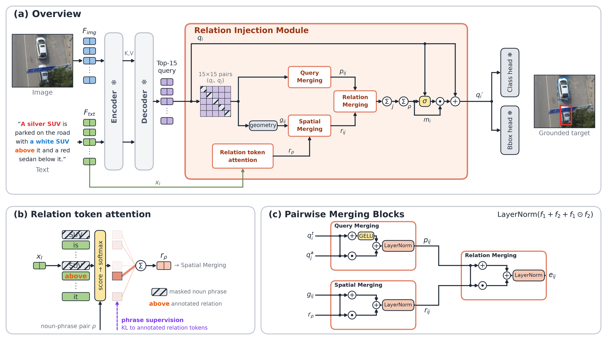

<div align="center">

# Pairwise relational perception with object queries for aerial visual grounding

</div>

This repository contains the code of Pairception for visual grounding in UAV images. A link to the paper will be
added after publication. Given a UAV image and an expression such as "the red car to the left of the blue bus", the
task is to find the one object the expression refers to. For this task, we keep the released
[AerialVG](https://github.com/Ideal-ljl/AerialVG) detector (ICCV 2025) frozen and train only a **Relation Injection
Module** of 461,955 parameters. For the 15 candidate queries with the highest scores, the module compares every ordered
pair of candidates with the noun phrases and the relation phrase of the expression, and adds the resulting relational
evidence to each query. The frozen bbox and class heads then place and score the updated queries again.

<p align="center"></p>

Panel (a) shows the Relation Injection Module between the frozen detector and its heads. In panel (b), relation-token
attention pools the expression tokens outside a noun-phrase pair into a relation representation. In panel (c), the
Pairwise Merging Blocks combine this representation with the queries of a candidate pair and their relative geometry.
The Pairwise Merging Blocks, the relation-token attention and the rest of the module are implemented in
[pairception/relation_injection.py](pairception/relation_injection.py).

## Results

AerialVG test split (all 4,723 expressions), in %. Top-k accuracy counts an expression as correct when one of the k
highest-scoring boxes overlaps the target box with IoU ≥ 0.5, and mIoU is the mean IoU of the highest-scoring box.
AerialVG is the released model with its relation module. AerialVG w/o relation module is the frozen detector that
Pairception updates, ranked by its own scores over its 15 highest-scoring candidates.

| Model | Top-1 | Top-5 | Top-15 | mIoU |
|---|---:|---:|---:|---:|
| AerialVG | 49.93 | 87.36 | 96.93 | 45.10 |
| AerialVG w/o relation module | 48.51 | 86.58 | 96.93 | 43.85 |
| Pairception ([checkpoint](https://github.com/whsihaun/pairception/releases/tag/v1.0)) | 74.83 | 94.03 | 96.97 | 67.38 |

The commands under [Evaluate](#evaluate) reproduce these rows with the CUDA kernel of deformable attention, and the
Pairception row is the released checkpoint, trained with seed 42. With this kernel, Pairception trained with seeds 42,
1 and 2 reaches a Top-1 of 74.83, 74.25 and 73.81 (mean 74.30). The paper measures the two AerialVG rows with the
PyTorch implementation of deformable attention instead of this kernel and reports a Top-1 of 50.60 and 49.67 and a
Top-5 of 87.91 and 87.59 for them. The two implementations round differently and can therefore reorder candidates
whose scores are nearly equal.

## Setup

```bash
git clone https://github.com/whsihaun/pairception.git
cd pairception
python -m venv .venv && source .venv/bin/activate
pip install -r requirements.txt
```

Run all commands from the repository root. We tested these commands with Python 3.13 and PyTorch 2.9.1 (CUDA 12.8)
on NVIDIA RTX A6000 GPUs. Building the kernel needs the CUDA compiler `nvcc` on `PATH`.

The AerialVG dataset is gated on Hugging Face: accept its terms on the
[dataset page](https://huggingface.co/datasets/IPEC-COMMUNITY/AerialVG) and log in with `hf auth login`. Then

```bash
bash scripts/prepare.sh
```

builds the kernel, downloads the dataset (1.3 GB), the released AerialVG checkpoint (0.7 GB), BERT (0.4 GB) and the
Stanza models (0.2 GB), and parses every expression once on the CPU (about 12 minutes). These files go to
`data/AerialVG`, `checkpoints/` and `cache/`, and results go to `outputs/`.

## Evaluate

```bash
bash scripts/download_checkpoint.sh
bash scripts/evaluate.sh
```

The first script downloads the released Pairception checkpoint, trained with seed 42 (1.7 MB), into `checkpoints/`.
The second script evaluates the three models of the table on the test split on GPU 0, which takes about 10 minutes per
model. Each evaluation prints Top-1, Top-5, Top-15 and mIoU on one line and writes them to `outputs/`. One model at a
time:

```bash
python -m pairception.evaluate --model pairception
```

`--model aerialvg` and `--model frozen_detector` evaluate the two AerialVG rows of the table, and `--split val`
evaluates on the validation split.

## Train

```bash
bash scripts/train.sh
```

The script trains Pairception with seed 42 on GPU 0 and then evaluates the best checkpoint on the test split. We
trained Pairception on one NVIDIA RTX A6000 (48 GB), which takes about 25 hours for 15 epochs with a validation
pass after each epoch. A stopped run starts again from the first epoch. The epoch with the best validation Top-1 (then
Top-5) is kept as `checkpoints/pairception_seed42.pt`, replacing a downloaded checkpoint of the same name, and the
validation results of every epoch go to `outputs/train_seed42.jsonl`. Both files are named after the training seed,
which `--seed` in the script changes. GPU kernels are not guaranteed to be deterministic, so the same seed may give
slightly different results on other hardware.

Training uses the 36,851 training expressions whose annotated phrases can be found in the expression tokens and
selects the epoch on the 4,606 such validation expressions. Evaluation always uses every expression of a split. The
annotated boxes of the auxiliary objects and the relation phrases enter only the training losses, so evaluation needs
only the image and the expression. The loss weights, the training schedule, the detector settings and the module size
are set in [pairception/config.py](pairception/config.py).

## License

The code in this repository is released under the [MIT License](LICENSE), except for `external/aerialvg/`. That folder
holds the files of the AerialVG code at commit
[db33e1d](https://github.com/Ideal-ljl/AerialVG/tree/db33e1dc733911853c5e132394d2e00b024334db) without changes, so
that the experiments run against the exact public code. The AerialVG repository states no license, and this code
therefore remains under the copyright of its authors and under the licenses given in the headers of its files. If you
are an author of AerialVG and would like this copy changed or removed, please open an issue. The AerialVG dataset,
including the image in `assets/pairception.png`, is under the terms of its
[dataset page](https://huggingface.co/datasets/IPEC-COMMUNITY/AerialVG), which allow non-commercial use only.

## Acknowledgements

Pairception builds on the code, the dataset and the released detector of
[AerialVG](https://github.com/Ideal-ljl/AerialVG). The AerialVG code in turn builds on
[GroundingDINO](https://github.com/IDEA-Research/GroundingDINO),
[Open-GroundingDino](https://github.com/longzw1997/Open-GroundingDino) and the deformable attention of
[Deformable DETR](https://github.com/fundamentalvision/Deformable-DETR). We thank the authors of these projects for
making their work public.
